# P&G Beauty — Entity Relationship Diagram

**Source of truth:** [`schema/idempotent/schema_complete.sql`](schema/idempotent/schema_complete.sql) — the canonical schema that is live on Supabase (project `lvtlehesxweckggyemnm`). Fresh installs use [`schema/split/schema_fresh.sql`](schema/split/schema_fresh.sql); existing databases use [`schema/split/schema_upgrade.sql`](schema/split/schema_upgrade.sql).
**Diagram formats:** Mermaid (paste into GitHub preview / mermaid.live) and DBML (import into dbdiagram.io).

## Identifier convention

Every table has a **surrogate primary key named after the entity it identifies** (`product_id`, `brand_id`, `variant_id`, …), and every foreign key column carries the **same name as the primary key it references**. This is what your reference notation describes — `BRANDS.brands_ID < PRODUCTS.brand_id` is implemented as `brands.brand_id → products.brand_id`:

| Reference notation (your draft) | Implemented in Postgres | Table |
|---|---|---|
| `BRANDS.brands_ID` | `brands.brand_id` | BRANDS |
| `CATEGORIES.categories_ID` | `categories.category_id` | CATEGORIES |
| `PRODUCTS.products_ID` | `products.product_id` | PRODUCTS |
| `PRODUCT_VARIANTS.product_variants_ID` | `product_variants.variant_id` | PRODUCT_VARIANTS |
| `PROFILES.profiles_ID` | `profiles.user_id` | PROFILES |
| `SUPPLIERS.suppliers_ID` | `suppliers.supplier_id` | SUPPLIERS |
| `PURCHASE_ORDERS.purchase_orders_ID` | `purchase_orders.purchase_order_id` | PURCHASE_ORDERS |
| `ORDERS.orders_ID` | `orders.order_id` | ORDERS |
| `SUPPORT_INQUIRIES.support_inquiries_ID` | `support_inquiries.inquiry_id` | SUPPORT_INQUIRIES |

Child tables keep their natural entity keys. `cart_items` uses a surrogate `cart_item_id` because its identity includes a nullable `variant_id` — uniqueness is enforced by the expression index `(user_id, product_id, coalesce(variant_id, nil))` so two variants of one product can share a cart.

---

## Mermaid

```mermaid
erDiagram
    AUTH_USERS ||--|| PROFILES : "auth identity"

    BRANDS ||--o{ PRODUCTS : brand_id
    CATEGORIES ||--o{ PRODUCTS : category_id
    PRODUCTS ||--o{ PRODUCT_VARIANTS : product_id
    PRODUCT_VARIANTS ||--|| INVENTORY : variant_id

    SUPPLIERS ||--o{ BRANDS : supplier_id
    SUPPLIERS ||--o{ PURCHASE_ORDERS : supplier_id
    PROFILES ||--o{ PURCHASE_ORDERS : created_by
    PURCHASE_ORDERS ||--o{ PURCHASE_ORDER_ITEMS : purchase_order_id
    PRODUCTS ||--o{ PURCHASE_ORDER_ITEMS : product_id
    PRODUCT_VARIANTS ||--o{ PURCHASE_ORDER_ITEMS : variant_id

    PROFILES ||--o{ ORDERS : user_id
    ORDERS ||--o{ ORDER_ITEMS : order_id
    PRODUCT_VARIANTS ||--o{ ORDER_ITEMS : variant_id
    ORDERS ||--o{ PAYMENTS : order_id
    ORDERS ||--o{ INVENTORY_MOVEMENTS : order_id
    PURCHASE_ORDERS ||--o{ INVENTORY_MOVEMENTS : purchase_order_id
    PRODUCT_VARIANTS ||--o{ INVENTORY_MOVEMENTS : variant_id
    PROFILES ||--o{ INVENTORY_MOVEMENTS : created_by

    CATEGORIES ||--o{ RECOMMENDATION_RULES : target_category_id
    PROFILES ||--o{ RECOMMENDATIONS : user_id
    PRODUCTS ||--o{ RECOMMENDATIONS : product_id
    RECOMMENDATIONS ||--o{ CUSTOMER_PRODUCT_INTERACTIONS : recommendation_id
    PROFILES ||--o{ CUSTOMER_PRODUCT_INTERACTIONS : user_id
    PRODUCTS ||--o{ CUSTOMER_PRODUCT_INTERACTIONS : product_id

    PROFILES ||--o{ USER_ACTIVITY_LOG : actor_id
    PROFILES ||--o{ CART_ITEMS : user_id
    PRODUCTS ||--o{ CART_ITEMS : product_id
    PRODUCT_VARIANTS ||--o{ CART_ITEMS : variant_id
    PROFILES ||--o{ WISHLIST_ITEMS : user_id
    PRODUCTS ||--o{ WISHLIST_ITEMS : product_id
    PROFILES ||--o{ USER_ADDRESSES : user_id
    PROFILES ||--o{ USER_PAYMENT_METHODS : user_id

    PROFILES ||--o{ SUPPORT_INQUIRIES : user_id
    SUPPORT_INQUIRIES ||--o{ SUPPORT_RESPONSES : inquiry_id

    PRODUCTS ||--o{ PRODUCT_REVIEWS : product_id
    PROFILES ||--o{ PRODUCT_REVIEWS : user_id

    AUTH_USERS {
        uuid id PK
    }

    PROFILES {
        uuid user_id PK "FK auth.users.id"
        text first_name
        text last_name
        text role "customer|beauty_staff|beauty_admin|super_admin"
        jsonb skin_profile
        text email
        text phone
        text document_number "government ID / document"
        date birthday
        text account_status "Active|Inactive"
        timestamptz last_seen_at
        timestamptz created_at
    }

    BRANDS {
        uuid brand_id PK
        text name UK
        text description
        uuid supplier_id FK "owning supplier (required)"
        timestamptz created_at
    }

    CATEGORIES {
        uuid category_id PK
        text name UK
        text description
        text image
        timestamptz created_at
    }

    PRODUCTS {
        uuid product_id PK
        uuid brand_id FK
        uuid category_id FK
        text name
        text description
        numeric price
        numeric original_price
        numeric sale_price "discounted price when on sale"
        text discount_type "percentage|fixed"
        numeric discount_value
        timestamptz discount_start
        timestamptz discount_end
        text image
        text[] images
        text[] tags
        numeric rating
        int reviews
        text badge
        text status "Active|Draft|Archived"
        timestamptz created_at
    }

    PRODUCT_VARIANTS {
        uuid variant_id PK
        uuid product_id FK
        text size
        numeric additional_price
        numeric supplier_price "hidden cost = listing / 1.30"
        text sku UK
        text_array images "up to 5 photos per variant"
    }

    INVENTORY {
        uuid inventory_id PK
        uuid variant_id FK "one stock row per variant"
        int stock_quantity
        int reorder_level
        timestamptz updated_at
    }

    SUPPLIERS {
        uuid supplier_id PK
        text name
        text contact_name
        text contact_email
        text phone
        text address
        text status "Active|Inactive|Archived"
        timestamptz created_at
    }

    PURCHASE_ORDERS {
        uuid purchase_order_id PK
        uuid created_by FK
        uuid supplier_id FK
        text status "Pending|Approved|Shipped|Received|Cancelled"
        numeric total_cost
        date expected_delivery
        text payment_terms
        text notes
        timestamptz created_at
        text po_no UK
    }

    PURCHASE_ORDER_ITEMS {
        uuid purchase_order_item_id PK
        uuid purchase_order_id FK
        uuid product_id FK
        uuid variant_id FK
        int quantity
        numeric unit_cost
    }

    ORDERS {
        uuid order_id PK
        uuid user_id FK
        numeric total_amount
        numeric subtotal
        numeric shipping_fee
        numeric tax
        text status "Pending|Processing|Shipped|Delivered|Cancelled"
        text payment_status "Unpaid|Paid|Refunded"
        text stripe_payment_intent_id
        text payment_method
        text shipping_name
        text shipping_email
        text shipping_phone
        text shipping_address
        text shipping_city
        text shipping_zip
        text shipping_country
        timestamptz created_at
        text order_no UK
    }

    ORDER_ITEMS {
        uuid order_item_id PK
        uuid order_id FK
        uuid variant_id FK
        int quantity
        numeric price_at_purchase
    }

    PAYMENTS {
        uuid payment_id PK
        uuid order_id FK
        text provider
        text provider_reference
        text status
        numeric amount
        timestamptz created_at
    }

    INVENTORY_MOVEMENTS {
        uuid movement_id PK
        uuid variant_id FK
        text movement_type "Stock In|Stock Out"
        int quantity
        int stock_after "stock level after this movement"
        text user_document "document number of the user who made the movement"
        text reference
        text notes
        uuid created_by FK
        timestamptz created_at
        text movement_no UK
        uuid order_id FK "set null"
        uuid purchase_order_id FK "set null"
    }

    RECOMMENDATION_RULES {
        uuid rule_id PK
        text rule_name
        text[] trigger_skin_type
        uuid target_category_id FK
        numeric weight_modifier
        boolean is_active
    }

    RECOMMENDATIONS {
        uuid recommendation_id PK
        uuid user_id FK
        uuid product_id FK
        numeric score
        text reason
        timestamptz created_at
    }

    CUSTOMER_PRODUCT_INTERACTIONS {
        uuid interaction_id PK
        uuid user_id FK
        uuid product_id FK
        uuid recommendation_id FK "set null"
        text interaction_type "view|recommendation_shown|recommendation_clicked|cart|wishlist|purchase"
        timestamptz created_at
    }

    USER_ACTIVITY_LOG {
        bigint activity_id PK
        uuid actor_id FK "set null"
        text action
        jsonb details
        timestamptz created_at
    }

    CART_ITEMS {
        uuid cart_item_id PK
        uuid user_id FK
        uuid product_id FK
        uuid variant_id FK
        int quantity
        timestamptz updated_at
    }

    WISHLIST_ITEMS {
        uuid user_id PK_FK
        uuid product_id PK_FK
        timestamptz created_at
    }

    USER_ADDRESSES {
        uuid address_id PK
        uuid user_id FK
        text label
        text full_name
        text line1
        text city
        text zip
        text phone
        boolean is_default
        timestamptz created_at
        timestamptz updated_at
    }

    USER_PAYMENT_METHODS {
        uuid payment_method_id PK
        uuid user_id FK
        text method_type "gcash|paymaya|credit|debit"
        text label
        text detail
        boolean is_default
        timestamptz created_at
    }

    SUPPORT_INQUIRIES {
        bigint inquiry_id PK
        uuid user_id FK "set null"
        text customer_name
        text email
        text subject
        text message
        text status "Open|Pending|Resolved"
        text channel
        text sentiment
        text support_reply
        text last_reply
        timestamptz created_at
    }

    SUPPORT_RESPONSES {
        bigint response_id PK
        bigint inquiry_id FK
        text customer_name
        text email
        text response
        timestamptz sent_at
    }

    PRODUCT_REVIEWS {
        uuid review_id PK
        uuid product_id FK
        uuid user_id FK
        smallint rating "1..5"
        text review "10..1200 chars"
        timestamptz created_at
    }

    ROLE_PERMISSIONS {
        text role PK "value of profiles.role, not an FK"
        text module PK
        text action PK
        timestamptz created_at
    }
```



---

## DBML

```dbml
// External, managed by Supabase Auth — not created by schema/idempotent/schema_complete.sql
Table auth_users {
  id uuid [pk]
}

Table profiles {
  user_id uuid [pk, ref: > auth_users.id, note: 'on delete cascade']
  first_name text [not null, default: '']
  last_name text [not null, default: '']
  role text [not null, default: 'customer', note: 'customer | beauty_staff | beauty_admin | super_admin']
  skin_profile jsonb [not null, default: '{}']
  email text
  phone text
  document_number text
  birthday date
  account_status text [not null, default: 'Active', note: 'Active | Inactive']
  last_seen_at timestamptz
  created_at timestamptz [not null, default: `now()`]
}

Table brands {
  brand_id uuid [pk]
  name text [unique, not null]
  description text
  supplier_id uuid [not null, ref: > suppliers.supplier_id, note: 'owning supplier - required']
  created_at timestamptz [not null, default: `now()`]
}

Table categories {
  category_id uuid [pk]
  name text [unique, not null]
  description text
  image text
  created_at timestamptz [not null, default: `now()`]
}

Table products {
  product_id uuid [pk]
  brand_id uuid [ref: > brands.brand_id]
  category_id uuid [ref: > categories.category_id]
  name text [not null]
  description text
  price numeric [not null]
  original_price numeric
  sale_price numeric
  discount_type text
  discount_value numeric
  discount_start timestamptz
  discount_end timestamptz
  image text
  images text[] [not null, default: '{}']
  tags text[] [not null, default: '{}']
  rating numeric [not null, default: 0]
  reviews integer [not null, default: 0]
  badge text
  status text [not null, default: 'Draft', note: 'Active | Draft | Archived']
  created_at timestamptz [not null, default: `now()`]
}

Table product_variants {
  variant_id uuid [pk]
  product_id uuid [not null, ref: > products.product_id]
  size text [not null]
  additional_price numeric [not null, default: 0.00]
  supplier_price numeric [not null, default: 0.00, note: 'hidden supplier cost - purchase order unit_cost']
  sku text [unique, not null]
  images text[] [not null, default: '{}', note: 'per-variant photos, max 5, public product-images URLs']
  expiry_date date [note: 'null = no expiry; expired/near-expiry (<= today+60d) hidden from customers']
}

Table inventory {
  inventory_id uuid [pk]
  variant_id uuid [not null, unique, ref: > product_variants.variant_id]
  stock_quantity integer [not null, default: 0]
  reorder_level integer [not null, default: 10]
  updated_at timestamptz [not null, default: `now()`]
}

Table suppliers {
  supplier_id uuid [pk]
  name text [not null]
  contact_name text [not null, default: '']
  contact_email text
  phone text
  address text
  status text [not null, default: 'Active', note: 'Active | Inactive | Archived']
  created_at timestamptz [not null, default: `now()`]
}

Table purchase_orders {
  purchase_order_id uuid [pk]
  created_by uuid [ref: > profiles.user_id]
  supplier_id uuid [ref: > suppliers.supplier_id]
  status text [not null, default: 'Pending', note: 'Pending | Approved | Shipped | Received | Cancelled']
  total_cost numeric [not null, default: 0]
  expected_delivery date
  payment_terms text [not null, default: '']
  notes text [not null, default: '']
  created_at timestamptz [not null, default: `now()`]
  po_no text [unique]
}

Table purchase_order_items {
  purchase_order_item_id uuid [pk]
  purchase_order_id uuid [not null, ref: > purchase_orders.purchase_order_id]
  product_id uuid [not null, ref: > products.product_id]
  variant_id uuid [ref: > product_variants.variant_id]
  quantity integer [not null]
  unit_cost numeric [not null]
}

Table orders {
  order_id uuid [pk]
  user_id uuid [not null, ref: > profiles.user_id]
  total_amount numeric [not null]
  subtotal numeric [not null, default: 0]
  shipping_fee numeric [not null, default: 0]
  tax numeric [not null, default: 0]
  status text [not null, default: 'Pending', note: 'Pending | Processing | Shipped | Delivered | Cancelled']
  payment_status text [not null, default: 'Unpaid', note: 'Unpaid | Paid | Refunded']
  stripe_payment_intent_id text
  payment_method text [not null, default: 'card']
  shipping_name text [not null, default: '']
  shipping_email text [not null, default: '']
  shipping_phone text
  shipping_address text [not null, default: '']
  shipping_city text [not null, default: '']
  shipping_zip text [not null, default: '']
  shipping_country text [not null, default: 'Philippines']
  created_at timestamptz [not null, default: `now()`]
  order_no text [unique]
}

Table order_items {
  order_item_id uuid [pk]
  order_id uuid [not null, ref: > orders.order_id]
  variant_id uuid [not null, ref: > product_variants.variant_id]
  quantity integer [not null]
  price_at_purchase numeric [not null]
}

Table payments {
  payment_id uuid [pk]
  order_id uuid [not null, ref: > orders.order_id]
  provider text [not null]
  provider_reference text
  status text [not null, default: 'Pending']
  amount numeric [not null]
  created_at timestamptz [not null, default: `now()`]
}

Table inventory_movements {
  movement_id uuid [pk]
  variant_id uuid [not null, ref: > product_variants.variant_id]
  movement_type text [not null, note: 'Stock In | Stock Out']
  quantity integer [not null]
  stock_after integer [not null, default: 0]
  user_document text
  reference text
  notes text
  created_by uuid [ref: > profiles.user_id]
  created_at timestamptz [not null, default: `now()`]
  movement_no text [unique]
  order_id uuid [ref: > orders.order_id, note: 'set null on delete']
  purchase_order_id uuid [ref: > purchase_orders.purchase_order_id, note: 'set null on delete']
}

Table recommendation_rules {
  rule_id uuid [pk]
  rule_name text [not null]
  trigger_skin_type text[] [not null, default: '{}']
  target_category_id uuid [ref: > categories.category_id]
  weight_modifier numeric [not null, default: 1.00]
  is_active boolean [not null, default: true]
}

Table recommendations {
  recommendation_id uuid [pk]
  user_id uuid [not null, ref: > profiles.user_id]
  product_id uuid [not null, ref: > products.product_id]
  score numeric [not null]
  reason text [not null]
  created_at timestamptz [not null, default: `now()`]
}

Table customer_product_interactions {
  interaction_id uuid [pk]
  user_id uuid [not null, ref: > profiles.user_id]
  product_id uuid [not null, ref: > products.product_id]
  recommendation_id uuid [ref: > recommendations.recommendation_id, note: 'set null on delete']
  interaction_type text [not null, note: 'view | recommendation_shown | recommendation_clicked | cart | wishlist | purchase']
  created_at timestamptz [not null, default: `now()`]
}

Table user_activity_log {
  activity_id bigint [pk]
  actor_id uuid [ref: > profiles.user_id, note: 'set null on delete']
  action text [not null]
  details jsonb [not null, default: '{}']
  created_at timestamptz [not null, default: `now()`]
}

Table cart_items {
  cart_item_id uuid [pk, default: `gen_random_uuid()`]
  user_id uuid [not null, ref: > profiles.user_id]
  product_id uuid [not null, ref: > products.product_id]
  variant_id uuid [ref: > product_variants.variant_id]
  quantity integer [not null]

  indexes {
    (user_id, product_id, coalesce(variant_id, "00000000-0000-0000-0000-000000000000")) [unique, name: 'cart_items_user_product_variant_key']
  }
  updated_at timestamptz [not null, default: `now()`]
}

Table wishlist_items {
  user_id uuid [pk, not null, ref: > profiles.user_id]
  product_id uuid [pk, not null, ref: > products.product_id]
  created_at timestamptz [not null, default: `now()`]
}

Table user_addresses {
  address_id uuid [pk]
  user_id uuid [not null, ref: > profiles.user_id]
  label text [not null, default: 'Home']
  full_name text [not null]
  line1 text [not null]
  city text [not null]
  zip text [not null]
  phone text [not null, default: '']
  is_default boolean [not null, default: false]
  created_at timestamptz [not null, default: `now()`]
  updated_at timestamptz [not null, default: `now()`]
}

Table user_payment_methods {
  payment_method_id uuid [pk]
  user_id uuid [not null, ref: > profiles.user_id]
  method_type text [not null, note: 'gcash | paymaya | credit | debit']
  label text [not null]
  detail text [not null, default: '']
  is_default boolean [not null, default: false]
  created_at timestamptz [not null, default: `now()`]
}

Table support_inquiries {
  inquiry_id bigint [pk]
  user_id uuid [ref: > profiles.user_id, note: 'set null on delete']
  customer_name text [not null, default: 'Customer']
  email text [not null]
  subject text [not null, default: 'Support Request']
  message text [not null]
  status text [not null, default: 'Open', note: 'Open | Pending | Resolved']
  channel text [not null, default: 'Chat']
  sentiment text [not null, default: 'Needs review']
  support_reply text [default: '']
  last_reply text [default: 'Just now']
  created_at timestamptz [not null, default: `now()`]
}

Table support_responses {
  response_id bigint [pk]
  inquiry_id bigint [not null, ref: > support_inquiries.inquiry_id]
  customer_name text [not null]
  email text [not null]
  response text [not null]
  sent_at timestamptz [not null, default: `now()`]
}

Table product_reviews {
  review_id uuid [pk]
  product_id uuid [not null, ref: > products.product_id]
  user_id uuid [not null, ref: > profiles.user_id]
  rating smallint [not null, note: '1..5']
  review text [not null, note: '10..1200 chars']
  created_at timestamptz [not null, default: `now()`]
}

Table role_permissions {
  role text [pk, note: 'beauty_staff | beauty_admin; super_admin bypasses, customer has no rows']
  module text [pk, note: 'dashboard | products | inventory | suppliers | purchases | customers | activity | sales | insights | recommendations | reports | support | users | settings']
  action text [pk, note: 'view | create | edit | manage | generate | export | respond | delete']
  created_at timestamptz [not null, default: `now()`]

  Note: 'RBAC grant matrix - single source of truth for has_permission()/get_my_permissions(). RLS enabled with NO policies (nobody reads it directly; only the security-definer functions do).'
}
```

---

## Reference list (your draft → implemented)

| Your reference | Implemented as |
|---|---|
| `BRANDS.brands_ID < PRODUCTS.brand_id` | `brands.brand_id → products.brand_id` (1:N) |
| `CATEGORIES.categories_ID < PRODUCTS.category_id` | `categories.category_id → products.category_id` (1:N) |
| `PRODUCTS.products_ID < PRODUCT_VARIANTS.product_id` | `products.product_id → product_variants.product_id` (1:N) |
| `PRODUCT_VARIANTS.product_variants_ID - INVENTORY.variant_id` | `product_variants.variant_id → inventory.variant_id` (1:1, unique) |
| `PRODUCT_VARIANTS.product_variants_ID < INVENTORY_MOVEMENTS.variant_id` | `product_variants.variant_id → inventory_movements.variant_id` (1:N) |
| `PROFILES.profiles_ID ?< INVENTORY_MOVEMENTS.created_by` | `profiles.user_id → inventory_movements.created_by` (1:N, nullable) |
| `ORDERS.orders_ID ?< INVENTORY_MOVEMENTS.order_id` | `orders.order_id → inventory_movements.order_id` (1:N, nullable, set null) |
| `PURCHASE_ORDERS.purchase_orders_ID ?< INVENTORY_MOVEMENTS.purchase_order_id` | `purchase_orders.purchase_order_id → inventory_movements.purchase_order_id` (1:N, nullable, set null) |
| `SUPPLIERS.suppliers_ID < PURCHASE_ORDERS.supplier_id` | `suppliers.supplier_id → purchase_orders.supplier_id` (1:N) |
| `PROFILES.profiles_ID < PURCHASE_ORDERS.created_by` | `profiles.user_id → purchase_orders.created_by` (1:N) |
| `PURCHASE_ORDERS.purchase_orders_ID < PURCHASE_ORDER_ITEMS.purchase_order_id` | `purchase_orders.purchase_order_id → purchase_order_items.purchase_order_id` (1:N) |
| `PRODUCT_VARIANTS.product_variants_ID < PURCHASE_ORDER_ITEMS.variant_id` | `product_variants.variant_id → purchase_order_items.variant_id` (1:N, nullable) |
| `PROFILES.profiles_ID < ORDERS.user_id` | `profiles.user_id → orders.user_id` (1:N) |
| `ORDERS.orders_ID < ORDER_ITEMS.order_id` | `orders.order_id → order_items.order_id` (1:N) |
| `PRODUCT_VARIANTS.product_variants_ID < ORDER_ITEMS.variant_id` | `product_variants.variant_id → order_items.variant_id` (1:N) |
| `ORDERS.orders_ID < PAYMENTS.order_id` | `orders.order_id → payments.order_id` (1:N) |
| `CATEGORIES.categories_ID < RECOMMENDATION_RULES.target_category_id` | `categories.category_id → recommendation_rules.target_category_id` (1:N) |
| `PROFILES.profiles_ID < CART_ITEMS.user_id` | `profiles.user_id → cart_items.user_id` (1:N) |
| `PRODUCT_VARIANTS.product_variants_ID < CART_ITEMS.variant_id` | `product_variants.variant_id → cart_items.variant_id` (1:N, nullable) |
| `PROFILES.profiles_ID < WISHLIST_ITEMS.user_id` | `profiles.user_id → wishlist_items.user_id` (1:N) |
| `PRODUCTS.products_ID < WISHLIST_ITEMS.product_id` | `products.product_id → wishlist_items.product_id` (1:N) |
| `PROFILES.profiles_ID ?< SUPPORT_INQUIRIES.user_id` | `profiles.user_id → support_inquiries.user_id` (1:N, nullable, set null) |
| `SUPPORT_INQUIRIES.support_inquiries_ID < SUPPORT_RESPONSES.inquiry_id` | `support_inquiries.inquiry_id → support_responses.inquiry_id` (1:N) |
| `PROFILES.profiles_ID < USER_ADDRESSES.user_id` | `profiles.user_id → user_addresses.user_id` (1:N) |
| `PROFILES.profiles_ID < USER_PAYMENT_METHODS.user_id` | `profiles.user_id → user_payment_methods.user_id` (1:N) |

Additional real relationships also modelled in the schema (beyond your draft):

| Relationship | Purpose |
|---|---|
| `products.product_id → product_reviews.product_id` | customer reviews of a delivered product |
| `profiles.user_id → product_reviews.user_id` | one review per customer per product (`unique(product_id, user_id)`) |
| `profiles.user_id → recommendations.user_id` | personalised "For You" list |
| `products.product_id → recommendations.product_id` | scored product |
| `profiles.user_id → customer_product_interactions.user_id` | behaviour tracking (view/cart/wishlist/purchase) |
| `products.product_id → customer_product_interactions.product_id` | behaviour per product |
| `recommendations.recommendation_id → customer_product_interactions.recommendation_id` | ties an interaction back to the recommendation that produced it |
| `profiles.user_id → user_activity_log.actor_id` | audit trail for the Activity Log page |

### Cardinality legend

| Symbol | Meaning in this schema |
|---|---|
| `||--o{` | one-to-many (parent → children) |
| `||--||` | one-to-one (`product_variants.variant_id` is unique in `inventory`) |
| `?` | nullable foreign key (`created_by`, `order_id`, `purchase_order_id`, `user_id` on support) |

### Delete behaviour

| Relationship | On delete |
|---|---|
| `products → product_variants / cart_items / wishlist_items / recommendations / customer_product_interactions / product_reviews` | `CASCADE` (child rows die with the product) |
| `profiles → orders / cart_items / wishlist_items / user_addresses / user_payment_methods / recommendations` | `CASCADE` |
| `profiles → inventory_movements.created_by / user_activity_log.actor_id` | `SET NULL` (audit history survives) |
| `orders → order_items / payments` | `CASCADE`; `orders → inventory_movements.order_id` | `SET NULL` |
| `purchase_orders → purchase_order_items` | `CASCADE`; `purchase_orders → inventory_movements.purchase_order_id` | `SET NULL` |

---

## Design notes to say out loud in the presentation

1. **Every PK is named after its entity** (`product_id`, `brand_id`, `variant_id`) and every FK uses the *same* name as the PK it points to — that is why `products.brand_id` points at `brands.brand_id`, and it is what makes the ERD self-documenting.
2. **Stock is tracked per variant, not per product.** `inventory.variant_id` is unique: one stock row per SKU. `product_variants` is what connects catalogue to stock.
3. **Suppliers own the products through brands.** `brands.supplier_id` is required: one supplier owns many unique brands, each brand owns its products, and each product owns its size variants. The chain is `suppliers -> brands -> products -> product_variants`; there is no supplier/product junction table. `purchase_orders` point at the supplier, and `purchase_order_items` at the exact product/variant ordered. The Suppliers page audit therefore counts brands/products/variants through this ownership chain.
4. **Every stock change is a ledger row.** `inventory_movements` is append-only and carries the reason: `order_id` (customer bought it) or `purchase_order_id` (supplier delivered it), plus `created_by` for who did it, `stock_after` (units remaining once the movement is applied) and `user_document` (the actor's `profiles.document_number`).
5. **Orders snapshot the shipping details** in `orders` rather than referencing `user_addresses`, so the historical order keeps the address that was used at purchase time.
6. **Row Level Security** is enabled on all 25 tables; every policy and privileged RPC calls `has_permission(module, action)`, which looks the role's grants up in the `role_permissions` table (single source of truth; `super_admin` bypasses, `customer` has no rows), and the browser never talks to tables directly for privileged actions — it calls RPCs (`place_order`, `record_inventory_movement`, `create_purchase_order`, `receive_purchase_order`, `submit_product_review`, `get_variant_supplier_costs`). The logged-in admin also fetches `get_my_permissions()` once per profile load so the UI hides/locks what the database would refuse anyway.
7. **Every account gets a document number.** `handle_new_user()` stamps `profiles.document_number` from the `document_no_seq` sequence (`DOC-000001` style), which is what the Customers page shows and what the inventory ledger records as `inventory_movements.user_document`.
8. **Discounts expire in the database, not just in the UI.** `expire_discounts()` reverts `products.price ← products.original_price`, clears `sale_price` / `discount_*`, and returns the products that just expired; `AdminDashboard` calls it on mount and every 30 seconds so a finished sale can never still show a strikethrough price.
9. **Ratings are derived, never stored twice.** `products.rating` and `products.reviews` are recalculated by the `refresh_product_rating` trigger on every `product_reviews` insert/update/delete, and the public product page reads the review rows live.
10. **The activity log is deliberately split.** `audit_user_activity()` (the `pg_audit` trigger) only records *staff* actions and returns early for customers and anonymous sessions; customer events are produced by `get_customer_activity()` (`order.placed`, `order.received`, `order.cancelled`, `support.ticket_submitted`) plus explicit `log_customer_activity('ai.chat', …)` calls from the beauty chat. Loyalty tiers come from `get_customer_segment()` so app and database can never disagree. Its `event_id` is `<entity-id>:<event>` (e.g. `5467c3a1-…:received`) because one order is reported by more than one branch (placed + received, or placed + cancelled) — a bare entity id would repeat and render duplicate React keys in the Activity Log table. `DataTable` additionally suffixes any colliding row key as a safety net.
11. **Guest access needs grants *and* RLS.** PostgREST returns `401 permission denied for table X` whenever a table-level `GRANT` is missing — even when RLS would hide every row — so the signed-out storefront needs `SELECT` on `suppliers` when embedded by admin-owned queries and on `support_inquiries` (to return an insert representation) while their policies stay staff-only, so guests still read zero rows. Guests insert support tickets through `support_inquiries_guest_insert` (`user_id is null`), and reviewer names come from the product-scoped `get_product_review_authors` RPC rather than a `profiles()` embed, which 401s for guests, is filtered to `NULL` for other customers, and would expose reviewer emails. The RPC is `security definer` with a fixed empty `search_path` and returns only display-name columns for reviewers of the requested product; the old `security_invoker = off` view was removed.
12. **Supplier cost is hidden and derived, never typed.** Each variant stores `product_variants.supplier_price`, the app listing price divided by 1.30 — the 30% markup lives in exactly one constant, `SUPPLIER_MARKUP_PERCENT` in `src/lib/catalog.ts`, so changing it changes no customer-facing price (shop prices are stored, never computed from cost). Purchase orders post only `variant_id` + `quantity`; `create_purchase_order` fills `purchase_order_items.unit_cost` server-side from that column and refuses a line when the supplier does not carry the product, so a cost can be neither faked nor shown. The column is also revoked from `anon` and `authenticated` (every other `product_variants` column the storefront and admins use stays granted), so nobody can read costs by calling PostgREST directly — the Purchases page gets them from `get_variant_supplier_costs`, which demands `purchases/view`. The admin modal reveals only the grand total, and `receive_purchase_order` increases stock for the exact variant ordered.
13. **Roles are enforced in three layers that all read one table.** `role_permissions` (32 seeded grants) is the only place a permission is written down: the sidebar hides modules it has no grant for (`hasModulePermission` prefers the map returned by `get_my_permissions()` and falls back to the static mirror in `src/lib/permissions.ts`), the router wraps every admin page in `RequirePermission`, and PostgRLS re-checks `has_permission()` inside every policy — so copying a URL or calling PostgREST directly gets the same answer as the UI.
14. **Product photos and variant photos never mix.** `products.image` / `products.images` (max 8, `{productId}/{uuid}.webp`) are the only photos used by cards, cart lines and wishlist items. `product_variants.images` (max 5, `{productId}/variants/{variantId}/{uuid}.webp`, enforced by `product_variants_images_max_check`) belong to one selectable variant and replace the detail-page and quick-view gallery while that variant is the effective selection (`selectedVariants[label] || options[0]`); variants without photos fall back to the product gallery. Because `product_variants` exposes column-level `SELECT` grants, `images` is listed in that grant list (inside `supabase/schema/idempotent/schema_complete.sql`) or every catalog read would 401.
15. **Expiry is per variant and hides the SKU, not the product.** `product_variants.expiry_date` (nullable in the database for legacy rows, but required in the admin UI and every seed) is shown in admin Products / Inventory and watched on the Dashboard. `Expired` = `expiry_date <= current_date`, `Near Expiry` = `<= current_date + 60 days`; both are removed from the storefront catalog (the product stays listed while another variant is sellable, and disappears only when none are), and `place_order` re-checks the date server-side so a cart built before the flag cannot be checked out. Because it is a readable `product_variants` column, `expiry_date` is part of the column-level `SELECT` grant list (inside `supabase/schema/idempotent/schema_complete.sql`).

---

## Roles & permission matrix

Four roles live in `profiles.role` (`customer | beauty_staff | beauty_admin | super_admin`). Grants are rows in `role_permissions(role, module, action)`; `has_permission(module, action)` reads that table (`super_admin` → always true, `customer` → always false, inactive accounts → false), and `get_my_permissions()` returns the caller's whole map (`{ module: [actions] }`) for the UI.

| Module | `super_admin` | `beauty_admin` | `beauty_staff` | `customer` |
|---|---|---|---|---|
| dashboard | all | view | — | — |
| products | all | view, create, edit, delete | — | — |
| inventory | all | view, create, edit, manage | view, manage | — |
| suppliers | all | view, create, edit, delete | — | — |
| purchases | all | view, create, manage, delete | — | — |
| customers | all | view, manage | — | — |
| activity | all | view | view | — |
| sales | all | view, manage | — | — |
| insights | all | view | — | — |
| recommendations | all | view | — | — |
| reports | all | view, generate, export | — | — |
| support | all | view, respond | — | — |
| users | all (bypass) | — (hidden) | — (hidden) | — |
| settings | all (bypass) | — (hidden) | — (hidden) | — |

`super_admin` has no rows — it bypasses the lookup entirely, so it inherits every future grant automatically (all 14 modules × 8 actions from `get_my_permissions()`). 32 seeded rows = 29 for `beauty_admin` + 3 for `beauty_staff`.

Enforcement layers, all consulting the same table:

1. **UI** — `hasModulePermission()` (`src/lib/permissions.ts`) prefers `user.permissions` (fetched once per profile load via `get_my_permissions()`) and falls back to the static mirror; the sidebar filters its items and action buttons disable without the grant.
2. **Routes** — `RequirePermission` in `src/App.tsx` sends an unpermitted admin to `getFirstAdminRoute(user)` (e.g. `beauty_staff` lands on `/admin/inventory`).
3. **Database** — every RLS policy and privileged RPC re-evaluates `has_permission()`, and `role_permissions` itself has RLS enabled with **no policies** plus revoked grants (only the security-definer functions read it).

## Bootstrap admin accounts

Seeded by `supabase/admin_accounts.sql` (run with `psql -v account_pwd=…`; the password never appears in a file):

| Email | Role | Status | Purpose |
|---|---|---|---|
| `beautyadmin@pgbeauty.test` | `beauty_admin` | Active | Full admin except Users & Settings (replaces `admin@`, `admin2@` — their roles, POs and stock movements were transferred here) |
| `beautystaff@pgbeauty.test` | `beauty_staff` | Active | Inventory + Activity Log only (replaces `1admin@`) |
| `admin3@pgbeauty.test` | `super_admin` | Active | Remaining super admin — owns Users & Settings |

The retired accounts `admin@pgbeauty.test`, `admin2@pgbeauty.test` and `1admin@pgbeauty.test` were deleted from `auth.users` (profiles cascade); their audit history was preserved: 24 purchase orders + 82 stock movements now belong to `beautyadmin@`, and the 3 seeded orders were reassigned to `maria.santos@pgbeauty.test`.

---

## App-to-Schema Audit

**Audit scope:** Every `supabase.from('table')` and `supabase.rpc('fn')` call in `src/` was compared against `schema/idempotent/schema_complete.sql`.

**Environment note:** `.env.local` carries `VITE_SUPABASE_URL` / `VITE_SUPABASE_PUBLISHABLE_KEY` for the project `lvtlehesxweckggyemnm`. This audit started as a static code-level comparison (app query surface vs. the consolidated schema file) and was then verified by executing `schema/idempotent/schema_complete.sql` against that live project, so `schema/idempotent/schema_complete.sql` is both the source of truth and the deployed state.

### Result: MATCH — no discrepancies

All 25 tables, 4 views, and every RPC/Edge Function the app calls are defined in `schema/idempotent/schema_complete.sql`. All column names referenced in the app's `.select()` / `.insert()` / `.update()` calls exist on the corresponding tables.

### Tables used by the app (all 25 present in schema)

| # | Table | App usage | Schema status |
|---|-------|-----------|---------------|
| 1 | `profiles` | Auth context, customer admin, recommendations, dashboard counts | ✅ Defined |
| 2 | `brands` | Product CRUD, catalog reads | ✅ Defined |
| 3 | `categories` | Product CRUD, catalog reads, recommendation rules | ✅ Defined |
| 4 | `products` | Catalog, product CRUD, order items, reviews, interactions | ✅ Defined |
| 5 | `product_variants` | Catalog variants, inventory, order items, purchase items | ✅ Defined |
| 6 | `inventory` | Stock reads, low-stock alerts, stock mutations | ✅ Defined |
| 7 | `suppliers` | Supplier CRUD, purchase orders | ✅ Defined |
| 8 | `purchase_orders` | PO lifecycle, receive flow | ✅ Defined |
| 9 | `purchase_order_items` | PO line items | ✅ Defined |
| 10 | `orders` | Checkout, order history, transactions, sales | ✅ Defined |
| 11 | `order_items` | Order line items | ✅ Defined |
| 12 | `payments` | Written by `place_order` RPC | ✅ Defined |
| 13 | `inventory_movements` | Written by `place_order` / `record_inventory_movement` / `receive_purchase_order` | ✅ Defined |
| 14 | `cart_items` | Cart context, wishlist/insights reads | ✅ Defined |
| 15 | `wishlist_items` | Wishlist context, insights reads | ✅ Defined |
| 16 | `user_addresses` | Customer account addresses | ✅ Defined |
| 17 | `user_payment_methods` | Customer account payment methods | ✅ Defined |
| 18 | `recommendation_rules` | Recommendation engine rules | ✅ Defined |
| 19 | `recommendations` | "For You" recommendations | ✅ Defined |
| 20 | `customer_product_interactions` | Behavior tracking, recommendations | ✅ Defined |
| 21 | `user_activity_log` | Staff actions via the `audit_user_activity` trigger + explicit `log_customer_activity('ai.chat')` from the chat; customer events are derived by `get_customer_activity()` | ✅ Defined |
| 22 | `support_inquiries` | Support tickets (chat + admin inbox) | ✅ Defined |
| 23 | `support_responses` | Support agent replies | ✅ Defined |
| 24 | `product_reviews` | Product reviews via `submit_product_review` RPC | ✅ Defined |
| 25 | `role_permissions` | Not queried directly — read only by `has_permission()` (every RLS policy) and `get_my_permissions()` (AuthContext) | ✅ Defined + seeded (32 grants) |

### Views used by the app (all 3 present in schema)

| # | View | App usage | Schema status |
|---|------|-----------|---------------|
| 27 | `product_sales` | Admin sales summary, dashboard | ✅ Defined |
| 28 | `sales_by_month` | Admin dashboard sales trend | ✅ Defined |
| 29 | `underperforming_products` | Defined in schema; not yet queried by frontend | ✅ Defined |

### RPCs called by the app (all present in schema)

| # | RPC | Caller | Schema status |
|---|-----|--------|---------------|
| 1 | `place_order` | `src/lib/catalog.ts` (`createOrder`) | ✅ Defined + granted |
| 2 | `record_inventory_movement` | `src/pages/admin/AdminInventory.tsx` | ✅ Defined + granted |
| 3 | `create_purchase_order` | `src/lib/adminData.ts` — variant-level lines (`product_id` + `variant_id` + `quantity`); validates the product is owned by a brand of that supplier and reads `unit_cost` from the hidden `product_variants.supplier_price` | ✅ Defined + granted |
| 4 | `receive_purchase_order` | `src/lib/adminData.ts` | ✅ Defined + granted |
| 5 | `submit_product_review` | `src/components/ProductModal.tsx` | ✅ Defined + granted |
| 6 | `touch_user_activity` | `src/context/AuthContext.tsx` | ✅ Defined + granted |
| 7 | `get_staff_activity` | `src/lib/adminData.ts` (`fetchUserActivity`) | ✅ Defined + granted |
| 8 | `get_customer_activity` | `src/lib/adminData.ts` (`fetchCustomerActivity`) | ✅ Defined + granted |
| 9 | `set_customer_account_status` | `src/lib/adminData.ts` | ✅ Defined + granted |
| 10 | `get_customer_segment` | `src/lib/adminData.ts` (`fetchCustomers`) — loyalty tier per customer | ✅ Defined + granted |
| 11 | `expire_discounts` | `src/lib/catalog.ts` (`expireEndedDiscounts`), fired by `AdminDashboard.tsx` on mount and every 30s | ✅ Defined + granted |
| 12 | `log_customer_activity` | `src/components/FloatingChat.tsx` (`ai.chat` only) | ✅ Defined + granted |
| 13 | `touch_customer_activity` | Defined in schema; not yet called by frontend | ✅ Defined |
| 14 | `get_variant_supplier_costs` | `src/lib/adminData.ts` (`fetchPurchaseCatalog`) — returns hidden `supplier_price` rows for the PO grand total; gated by `purchases/view`, and the column itself is revoked from `anon`/`authenticated` | ✅ Defined + granted |
| 15 | `get_my_permissions` | `src/context/AuthContext.tsx` (non-customer profile load) — returns `{ module: [actions] }` from `role_permissions`; UI fallback when the RPC is unavailable | ✅ Defined + granted |
| 16 | `get_search_suggestions` | `src/lib/searchSuggestions.ts` (`CustomerNav`) - up to five frequent products and five non-cancelled top sellers; guests get the global interaction fallback | Defined + granted |
| 17 | `get_product_review_authors` | `src/pages/customer/ProductDetailPage.tsx` - product-scoped reviewer display names; only name columns are returned, with execute limited to `anon, authenticated` | Defined + granted |

### RPCs that exist for database triggers (not called by the frontend)

| # | RPC | Purpose | Schema status |
|---|-----|---------|---------------|
| 16 | `handle_new_user` | `auth` trigger — fills `first_name`, `last_name`, `email`, `skin_profile` and stamps `profiles.document_number` from `document_no_seq` | ✅ Defined |
| 17 | `audit_user_activity` | `pg_audit` trigger — **staff-only**: returns early for customers and for unauthenticated sessions | ✅ Defined |
| 18 | `refresh_product_rating` | Trigger `trg_refresh_product_rating` keeps `products.rating` / `products.reviews` in sync with `product_reviews` | ✅ Defined |

`has_permission(module, action)` is not called by the frontend directly — it is the security-definer helper inside every RLS policy and privileged RPC (table lookup in `role_permissions`).

### Sequences

| # | Sequence | Purpose |
|---|----------|---------|
| 1 | `document_no_seq` | Generates `DOC-000001`-style `profiles.document_number` values in `handle_new_user()`; read by the Customers page and written to `inventory_movements.user_document` |

### Edge Function called by the app (present in supabase/functions/)

| # | Function | Caller | Tables touched |
|---|----------|--------|----------------|
| 1 | `manage-user` | `src/lib/adminData.ts` (`manageUser`) | `profiles`, `user_activity_log`, `auth.users` |

### Storage bucket used by the app

| # | Bucket | App usage | Schema status |
|---|--------|-----------|---------------|
| 1 | `product-images` | `src/lib/productImages.ts` (upload/remove product photos and per-variant photos under `{productId}/variants/{variantId}/`) | ✅ Defined + policies |

### Columns referenced by the app that exist in the schema

Every column referenced in app queries was verified present:

- `profiles`: user_id, first_name, last_name, email, phone, role, skin_profile, account_status, last_seen_at, created_at, document_number
- `brands`: brand_id, name, description, supplier_id, created_at
- `categories`: category_id, name, description, image, created_at
- `products`: product_id, brand_id, category_id, name, description, price, original_price, sale_price, discount_type, discount_value, discount_start, discount_end, image, images, tags, rating, reviews, badge, status, created_at
- `product_variants`: variant_id, product_id, size, additional_price, supplier_price, sku, images, expiry_date
- `inventory`: inventory_id, variant_id, stock_quantity, reorder_level, updated_at
- `suppliers`: supplier_id, name, contact_name, contact_email, phone, address, status, created_at
- `purchase_orders`: purchase_order_id, created_by, supplier_id, status, total_cost, expected_delivery, payment_terms, notes, created_at, po_no
- `purchase_order_items`: purchase_order_item_id, purchase_order_id, product_id, variant_id, quantity, unit_cost
- `orders`: order_id, user_id, total_amount, subtotal, shipping_fee, tax, status, payment_status, stripe_payment_intent_id, payment_method, shipping_name, shipping_email, shipping_phone, shipping_address, shipping_city, shipping_zip, shipping_country, created_at, order_no
- `order_items`: order_item_id, order_id, variant_id, quantity, price_at_purchase
- `payments`: payment_id, order_id, provider, provider_reference, status, amount, created_at
- `inventory_movements`: movement_id, variant_id, movement_type, quantity, stock_after, user_document, reference, notes, created_by, created_at, movement_no, order_id, purchase_order_id
- `cart_items`: cart_item_id, user_id, product_id, variant_id, quantity, updated_at
- `wishlist_items`: user_id, product_id, created_at
- `user_addresses`: address_id, user_id, label, full_name, line1, city, zip, phone, is_default, created_at, updated_at
- `user_payment_methods`: payment_method_id, user_id, method_type, label, detail, is_default, created_at
- `recommendation_rules`: rule_id, rule_name, trigger_skin_type, target_category_id, weight_modifier, is_active
- `recommendations`: recommendation_id, user_id, product_id, score, reason, created_at
- `customer_product_interactions`: interaction_id, user_id, product_id, recommendation_id, interaction_type, created_at
- `user_activity_log`: activity_id, actor_id, action, details, created_at
- `support_inquiries`: inquiry_id, user_id, customer_name, email, subject, message, status, channel, sentiment, support_reply, last_reply, created_at
- `support_responses`: response_id, inquiry_id, customer_name, email, response, sent_at
- `product_reviews`: review_id, product_id, user_id, rating, review, created_at
- `role_permissions`: role, module, action, created_at (composite PK `role + module + action`)

**Conclusion:** `schema/idempotent/schema_complete.sql` is the accurate, complete source of truth for the Supabase database that the running app uses. No schema drift was detected.
